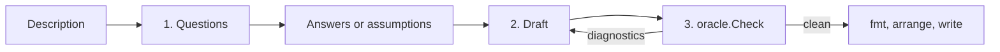

# Model from a Conversation

> Part of the [emod AI proposals](./README.md). Uses the [AI foundation](completed/00-llm-foundation.md): the
> `llm.Model` port, the providers, the configuration and the repair loop. This document does not specify
> them again.

## Problem

The first `.emod` file is the hardest step for a new user. The facilitator knows the business process:
"customers email us, we classify each email, and each complaint becomes a support case". But the
structure of an event model is not obvious to a new user: contexts, slices, the patterns of command, event,
view and automation, past-tense events, imperative commands.

A generator that writes a full model in one step removes the empty file, but it fills each gap in the
description with a guess. The output passes the check, it looks finished, and it hides each guess. In a
workshop, these gaps are the questions that the group exists to answer:

- Who or what starts the process?
- What is in scope, and what belongs to another team?
- What can fail, and does the business record the failure?
- Which external systems send or receive data?
- Which rules must stay true across more than one entity?

Therefore the generator asks these questions first. It writes the draft only after the answers, and it
states each assumption that stays in the draft. The facilitator then takes the draft and its assumptions to
the domain experts.

emod suits this task because it has its own check. A model that writes `.emod` text makes subtle errors: an
event named in the imperative, a view that subscribes to everything, a flow that names an event that does
not exist. `oracle.Check` finds all of them. The model does not have to be correct in one step. It has to
converge against the check in the repair loop of [00](completed/00-llm-foundation.md).

## Goals

- **G1:** `emod ai generate` turns a prose description into a valid, idiomatic `.emod` draft.
- **G2:** Before the draft, the command asks up to seven questions about actors, outcomes, boundaries, order,
  failures, external systems and consistency. Each question has lettered options, and the user can also
  write a free answer.
- **G3:** The draft states each assumption as a comment at the top of the file. `--json` lists the assumptions too.
- **G4:** Scripts can run the command with no prompt: `--answers <file>` gives the answers, and `--no-questions`
  skips the questions so that each gap becomes an assumption.
- **G5:** The draft passes the full check: no parse, validation or lint finding of any severity.
- **G6:** The same generator serves the desktop app and the MCP host, so each surface teaches the same style.
- **G7:** The run is honest. When the loop does not converge, the command shows the diagnostics that stay and
  never reports success.

## Non-Goals

- A model from code or artifacts that a team has already. That is [07](./07-model-import.md).
- Edits to a `.emod` file that exists. That is the AI panel of [03](./03-desktop-ai-panel.md).
- Specs and invariants. The draft records each rule from the answers as a comment. The Specify step turns
  the rules into invariants and specs, with the help of [05](./05-spec-suggestions.md).
- A free chat. The command has one round of questions, then it writes the draft.
- New DSL syntax. The generator writes the grammar of `docs/dsl-reference.md` as it is.

## How It Works



The logic lives in `internal/ai/generate`. It depends on `llm.Model`, `repair.Generate`, `oracle.Check`,
`formatter.Format` and `arrange.Model`. The CLI command in `internal/cli` is a thin wrapper, as `RunLint`
and `RunDiagram` are.

### Step 1: questions

The first call sends the description and asks for questions. It uses structured output: the `Schema` field
of `llm.GenerateRequest` asks for at most seven questions. Each question has a `topic`, a `text` and up to
four `options`. The topic is one of `actors`, `outcomes`, `boundaries`, `order`, `failures`,
`external-systems` and `consistency`.

The prompt tells the model to ask only about gaps that change the structure of the model. A detailed
description gets few questions or none. emod numbers the questions and gives the options the letters A to
D. The user answers with one line for each question: `2B` picks an option, and `2: <text>` gives a free
answer. A question with no answer becomes an assumption in the draft.

The `consistency` topic is the only way to DCB. The model asks it only when the description names a rule
that spans two or more entities, for example "a member holds at most five copies at one time". Otherwise
the draft uses the aggregate style, which is the common form that most readers know. For a draft in DCB,
the prompt adds the DCB knowledge of [02](./02-semantic-model-review.md#dcb-knowledge), and the `dcb/*` lint rules keep
the tags and the queries in shape during the repair loop.

### Step 2: the draft

The second call sends the description, the questions and the answers. It asks for one fenced `.emod`
block. `repair.Generate` takes the source from the fenced block, as [00](completed/00-llm-foundation.md) describes.

The draft holds:

- the actors, the contexts and the aggregates, or DCB slices with `tags` and `decides_on` when the answers
  name a rule across entities
- for each slice, a `description` of one sentence, taken from the description or the answers
- triggers with their `actor` and the view that they `reads`, when a person starts a step
- commands, events and their `fields`, views with `subscribes`, automations with `on` or `every`, `reads`
  and `target`, and translations for external systems
- the `flow` of each command slice
- an event for each failure that the business records, such as a declined payment
- a comment `# Assumption <n>: <text>` above `model` for each assumption
- a comment `# Rule: <text>` above the slice that the rule constrains, for each rule from the answers

The draft has no `spec` and no `invariants` block. When a model has one spec, the lint rules
`spec/command-without-spec` and `spec/no-rejection-path` ask for a spec on each command and a rejection for
each command that has a spec. To meet these rules, a draft needs an invariant for each command, and the
generator then invents rules. The `# Rule:` comments carry the stated rules to the Specify step
instead, where the group writes the invariants and the specs with [05](./05-spec-suggestions.md).

### What the prompt holds

The system prompt lives in `internal/ai/generate/prompt` and is embedded with `go:embed`. It holds:

- **The grammar.** The text of `cue.Schema`, the CUE schema that `emod schema` prints, and a short summary
  of `docs/dsl-reference.md`: the four slice patterns, `trigger`, `flow`, `fields`, `source = external(...)`,
  `type`, `description`, `mode`, `tags` and `decides_on`.
- **The rules.** emod builds the list of rules at run time from `linter.RuleDescription`, so the prompt
  states each lint rule in the words that the linter uses. A new lint rule reaches the prompt with no edit.
- **The examples.** `examples/all_patterns.emod` for the aggregate style, and `examples/dcb_model.emod` for
  DCB. A Go file in `examples/` embeds them, because `go:embed` cannot read a parent folder. The unit tests
  of `internal/cli` already make sure that each example passes the check, so the prompt never teaches a
  model that fails it.
- **The house rules of the draft.** The assumption and rule comments, no specs, aggregate style by default,
  and one sentence of `description` on each slice.

The MCP prompt `model-domain` of [01](./01-mcp-server.md) serves the same files, so the CLI, the desktop
app and the MCP host teach one style.

### Step 3: the check and the repair loop

`repair.Generate` runs `oracle.Check` on each draft. The check runs the parser, the validator and the
linter. The loop sends each diagnostic back with its rule name, for example `[god-view]` or
`[automation/missing-todo-list]`. The rule name lets the model fix the whole category in one attempt, not
only the one instance.

After the loop converges, emod parses the source, runs `arrange.Model` so that each view sits after the
slices it reads from, and writes the text with `formatter.Format`. The written draft therefore passes
`emod validate`, `emod fmt --check` and `emod slices arrange --check`.

Both calls use `EMOD_AI_MODEL`: the questions at effort `medium`, the draft at effort `high`. emod adds the
`Usage` of each call and shows the tokens.

When the loop does not converge after `--attempts` attempts, the command writes the last draft with the
comment `# DRAFT DID NOT PASS THE CHECK: <n> diagnostics` at the top. It prints the diagnostics as
`emod validate` prints them and exits with code 1. With `--strict`, it writes nothing.

### Surfaces

| Surface | How the user gets the questions | What emod adds |
| --- | --- | --- |
| CLI | `emod ai generate` prints the questions and reads the answers | The full flow in this document |
| Desktop app | "New model from description" in the AI panel of [03](./03-desktop-ai-panel.md). The panel shows the questions as a form with option buttons. | The same `internal/ai/generate` code. The panel shows the draft as a diagram with the assumptions beside it. The user accepts it and picks a file name. |
| MCP host | The prompt `model-domain` of [01](./01-mcp-server.md). The host model asks the questions in its own chat. | Only the prompt text and the tools. The host model writes the draft and calls `emod_validate` until the check is clean. |

## Interface

`generate` is a subcommand of `emod ai`. `emod ai` with no subcommand runs the configuration check of
[00](completed/00-llm-foundation.md).

```
emod ai generate [<description>] [flags]

  -o, --output <file>    write the draft to a file (default: stdout)
      --stdin            read the description from stdin
      --answers <file>   read the answers from a file, one line for each question; ask nothing
      --no-questions     ask nothing; each gap becomes an assumption
      --questions-only   print the questions and exit
      --attempts <n>     the limit of repair attempts (default 4)
      --effort <level>   low, medium, high or xhigh for the draft (default high)
      --strict           write nothing when the loop does not converge
      --json             print the result as JSON
```

When stdin is not a terminal and the command has neither `--answers` nor `--no-questions`, it exits with
code 2 and names the two flags. It does not wait for input that cannot come.

A script runs the command in two steps. The answers file has one line for each answer, in the same form as
the prompt: `1B`, or `2: The mail provider sends a webhook for each email`.

```
emod ai generate --questions-only --json "$(cat notes.txt)" > questions.json
emod ai generate --answers answers.txt -o inbound.emod "$(cat notes.txt)"
```

`--json` prints this object:

```json
{
  "converged": true,
  "attempts": 2,
  "questions": [{ "number": 1, "topic": "actors", "text": "...", "options": ["...", "..."] }],
  "answers": [{ "number": 1, "option": "B" }, { "number": 2, "text": "..." }],
  "assumptions": ["Nobody checks a classification before the system acts on it."],
  "rules": [{ "slice": "Classify Email", "text": "An email gets exactly one classification." }],
  "remaining": [],
  "usage": { "input_tokens": 14210, "output_tokens": 5120 },
  "source": "emod = 1\n..."
}
```

## Worked Example

The facilitator writes:

> Customers email us. We classify each email, and each complaint becomes a support case for an agent.

```
$ emod ai generate -o inbound.emod "Customers email us. We classify each email, and each complaint becomes a support case for an agent."

1. How does an email reach the system? (external-systems)
   A. The mail provider sends each email to the system
   B. A person forwards each email
2. Does a person check a classification before the system acts on it? (order)
   A. Yes, an agent approves each one
   B. No, the system acts at once
3. Who works a support case after it opens? (boundaries)
   A. The case system of the support team, outside this model
   B. This model, with its own slices for the agent
4. Can one email get two classifications? (failures)
   A. No, an email gets exactly one classification
   B. Yes, a later classification replaces the earlier one

answers> 1A 2B 3A 4A

draft with claude-opus-4-8 (effort high)...
  attempt 1: 2 diagnostics (automation/missing-todo-list, view/never-read)
  attempt 2: clean
wrote inbound.emod (2 contexts, 5 slices, 2 assumptions, 1 rule)
tokens: 14,210 in / 5,120 out
```

The written draft:

```emod
emod = 1

# Draft by `emod ai generate`. Check each assumption with the domain expert.
# Assumption 1: The mail provider sends each email to the system as an external event.
# Assumption 2: Nobody checks a classification before the system acts on it.
model "Inbound Customer Email" {
}

context "InboundEmail" {
  aggregate "Email" {
    slice "Receive Email" {
      description = "A customer email arrives from the mail provider"

      event "EmailReceived" {
        source = external("Mail Provider")

        fields {
          emailId = required(string)
          sender  = required(string)
        }
      }
    }

    slice "Emails to Classify" {
      description = "The system classifies each email that arrives"

      view "UnclassifiedEmailsView" {
        subscribes = [EmailReceived, EmailClassified]

        fields {
          emailId = required(string)
        }
      }

      automation "EmailClassifier" {
        on      = EmailReceived
        reads   = UnclassifiedEmailsView
        command = ClassifyEmail
      }
    }

    # Rule: an email gets exactly one classification.
    slice "Classify Email" {
      description = "The system records if an email is a question or a complaint"

      command "ClassifyEmail" {
        fields {
          emailId  = required(string)
          category = required(string)
        }
      }

      event "EmailClassified" {
        fields {
          emailId    = required(string)
          category   = required(string)
          confidence = required(decimal)
        }
      }

      flow = <<-FLOW
        command -> event:    ClassifyEmail -> EmailClassified
      FLOW
    }

    slice "Complaints to Escalate" {
      description = "The system opens a case for each complaint"

      view "ComplaintsToEscalateView" {
        subscribes = [EmailClassified, SupportCaseOpened]

        fields {
          emailId = required(string)
        }
      }

      automation "CaseOpener" {
        on      = EmailClassified
        reads   = ComplaintsToEscalateView
        command = OpenSupportCase

        target {
          context = SupportCases
        }
      }
    }
  }
}

context "SupportCases" {
  aggregate "SupportCase" {
    slice "Open Support Case" {
      description = "A complaint becomes a case for a support agent"

      command "OpenSupportCase" {
        fields {
          emailId = required(string)
          sender  = required(string)
        }
      }

      event "SupportCaseOpened" {
        fields {
          caseId  = required(string)
          emailId = required(string)
          sender  = required(string)
        }
      }

      flow = <<-FLOW
        command -> event:    OpenSupportCase -> SupportCaseOpened
      FLOW
    }
  }
}
```

Each answer changed the structure. Answer 1A made `EmailReceived` an external event, with no command.
Answer 2B kept an approval slice out of the draft. Answer 3A kept the work of the agent out of the model, so
`SupportCases` holds one slice. Answer 4A became a `# Rule:` comment, which the Specify step turns into an
invariant and a rejection spec.

The repair loop also fixed two diagnostics that a reader of the first draft does not see. In the first
draft, the automation `CaseOpener` had no `reads`, which `automation/missing-todo-list` reports, and nothing
read `ComplaintsToEscalateView`, which `view/never-read` reports. The loop sent both back, and the second
draft made `CaseOpener` read the view.

## Implementation Plan

**Phase 1: the generator (M).** `internal/ai/generate`: the question call with its schema, the answer
parser, the draft request, the embedded prompt files, the rule list from `linter.RuleDescription`, the
examples from an embed file in `examples/`, and the extraction of the assumption and rule comments from
`ast.Model.Comments` and the slice comments. Unit tests use `llm.Fake` for these paths: no questions,
answers from a file, convergence after N attempts, no convergence, and a `llm.Broken` model.

**Phase 2: the CLI (S).** `emod ai generate` with its flags, the prompt for the answers, the progress lines,
`--json`, the token line, and the exit codes. `arrange.Model` and
`formatter.Format` run on the converged source.

**Phase 3: the other surfaces (S).** The MCP prompt `model-domain` in [01](./01-mcp-server.md) serves the
embedded prompt files. The AI panel of [03](./03-desktop-ai-panel.md) calls
`internal/ai/generate` and shows the questions as a form.

**Phase 4: the evaluation corpus (M).** A folder of about 30 descriptions, each with a recorded set of
answers and a short list of expectations: the contexts, the events that the draft must name, and the
assumptions that it must state. A task runs the corpus against the tested tier of
[00](completed/00-llm-foundation.md) before each release and reports the rate of convergence, the mean number of
attempts, and the expectations that failed. The corpus needs a network, so it is not part of the unit
tests. Recorded responses from the corpus also feed `llm.Fake` in a regression test that runs with no
network.

## Risks and Mitigations

- **The draft looks authoritative.** A clean check does not mean that the model is true for the domain.
  The draft starts with the assumptions, and the CLI says that the check proves validity, not intent.
- **Too many questions.** Seven questions is the limit, and a detailed description gets fewer. The user
  can answer a question with no answer, and the gap becomes an assumption.
- **The loop does not converge.** `--attempts` limits the loop. The command writes the last draft with its
  diagnostics and exits with code 1, or writes nothing with `--strict`.
- **The prompt drifts from the grammar.** The rules come from `linter.RuleDescription` at run time, the
  grammar comes from `cue.Schema`, and the examples are files that the tests check. The corpus of Phase 4
  finds the drift that stays.
- **A weaker model.** The check catches structural errors from any provider. The questions and the names
  are weaker on a model of the compatible tier of [00](completed/00-llm-foundation.md), and the CLI prints the
  notice of that tier.
- **Data and cost.** The description and the answers go to the provider, and each attempt adds tokens. The
  command prints the tokens of each run. A team with a confidential domain uses a local server through the
  `openai` provider.

## Open Questions

- **A second round of questions.** Some answers raise new gaps. One round keeps the command simple. A
  second round can come when the corpus shows that the first round leaves too many assumptions.
- **A record of the conversation.** The questions and the answers are a record of the workshop. emod can
  write them beside the draft, for example as `inbound.questions.md`.
- **Specs in the draft.** When the answers state rules, the draft can carry the invariants and the
  rejection specs. This needs a spec for each command, so it waits for the spec suggestions of
  [05](./05-spec-suggestions.md).
- **The limit for DCB.** One rule across two entities is the signal for DCB now. The corpus can show if the
  signal is too weak or too strong.
