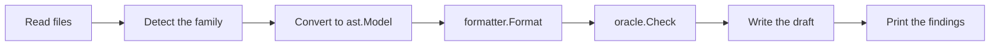

# Model Import

> Part of the [emod AI proposals](./README.md). The converters in this document use no language model. The
> import of code runs in an MCP host through the server of [01](./01-mcp-server.md). See the
> [AI foundation](completed/00-llm-foundation.md) for where AI runs.

## Problem

Most teams that model events have the system already. Its events, commands, projections and integrations
are in the code, in an [EventCatalog](https://www.eventcatalog.dev) site, in AsyncAPI documents, or in
emlang files. A facilitator who writes the `.emod` file by hand reads these artifacts again and types what
they state already.

The inputs are of two kinds, and each kind needs a different tool:

- **Structured artifacts state their content.** An AsyncAPI document names each message, its payload
  schema and the application that sends or receives it. A converter reads this with no guess. A language
  model adds cost, latency and a chance to invent, and it gives nothing that the artifact does not state.
- **Code states its content across many files and languages.** A handler class, a Kafka listener and a
  projection show the process only to a reader who understands the code. An agent for code, such as
  Claude Code or Cursor, reads code better than a set of heuristic extractors in emod. The agent already
  has access to the files and is already where developers work. With the MCP server of [01](./01-mcp-server.md), the agent
  checks its own draft against emod.

Therefore emod adds deterministic converters for the structured artifacts, and an MCP prompt for the import
of code. emod adds no language model code for import.

The output is a draft for the workshop, not a verified model. An artifact describes the messages at the
boundary of a system. It does not describe the commands and the views inside the process. The draft states
what the artifact does not say, and the group fills the gaps in the Shape step.

## Goals

- **G1:** `emod import <path> --from emlang|eventcatalog|asyncapi` writes a draft `.emod` with no language model
  and no network. `--from auto` detects the family and is the default.
- **G2:** The same input always gives the same draft, byte for byte.
- **G3:** The draft has no diagnostic of severity error. A converter never writes an element that the validator
  rejects, such as an orphan command, an orphan event or a reference that does not resolve.
- **G4:** Each draft starts with a provenance header. Each place where the artifact is silent gets a `# DRAFT:`
  comment.
- **G5:** After the write, the command runs `oracle.Check` and prints the lint findings. These findings are smells
  that the draft inherits from the artifact, for example a message named `InvoiceStatusUpdated`.
- **G6:** The MCP prompt `import-from-code` of [01](./01-mcp-server.md) guides an MCP host through the import of
  code.

## Non-Goals

- A language model inside emod for import.
- A code analyzer in emod for Go, Kotlin, Java, TypeScript or any other language.
- A path from `.emod` back to an artifact, or a sync between them. Import is one step. A second run
  overwrites the draft only with `--force`.
- A merge into a model that the group edited. See [Open Questions](#open-questions).
- A model from prose. That is [04](./04-model-from-conversation.md).
- A fix for the inherited smells. The group fixes them in the workshop, with the rename of
  [06](./06-rename-and-fix-suggestions.md).

## How It Works

| Input | Path | Who reads it | What emod adds |
| --- | --- | --- | --- |
| emlang files, an EventCatalog folder, AsyncAPI documents | `emod import` | A converter in emod | The converters and the CLI command |
| Source code | An MCP host with the prompt `import-from-code` | The host model | The prompt text and the MCP tools of [01](./01-mcp-server.md) |

### The converters



The code lives in `internal/convert`. The package holds the parts that each converter shares: the table of
field types, the rules for names, and the `# DRAFT:` comments. One subpackage holds each family:
`internal/convert/emlang`, `internal/convert/asyncapi` and `internal/convert/eventcatalog`. The name is
`convert` and not `importer`, because `internal/importer` already turns the diagram JSON of the viewer back
into an `ast.Model`.

Each converter builds an `ast.Model` with its comments. `formatter.Format` writes the text, as it does for
`internal/importer`, so emod has one writer of `.emod` text. The converters read YAML with
`gopkg.in/yaml.v3`, which the module already has as an indirect dependency, and read payload schemas with
`github.com/google/jsonschema-go`, which is already a direct dependency.

The command checks the text before it writes it. If `oracle.Check` reports an error, the command writes
nothing, prints the errors and exits with code 2. Such an error is a defect in the converter, and the
golden tests of each converter exist to prevent it.

With `--from auto`, the command detects the family from the input:

| Signal | Family |
| --- | --- |
| A YAML or JSON file with a top-level `asyncapi` key | `asyncapi` |
| A folder with `events/`, `services/` or `domains/`, where each item has an `index.mdx` | `eventcatalog` |
| A file that ends in `.emlang.yaml`, or a YAML file with a top-level `slices` key | `emlang` |

An input that matches no row stops the command with code 2 and a message that names the `--from` flag.

### Names

The converters keep the names of the artifact. They remove only the word `Event` at the end of an event
name and the word `Command` at the end of a command name, because emod states the kind of each element
already. They do not fix a name. The linter reports a weak name, and the group decides.

### Field types

AsyncAPI, EventCatalog and many emlang files describe payloads with JSON Schema. The converters share one
table:

| JSON Schema | emod field type |
| --- | --- |
| `string` | `string` |
| `string` with `format: date` | `date` |
| `string` with `format: date-time` | `timestamp` |
| `string` with `format: uuid` | `uuid` |
| `integer` | `int` |
| `number` | `decimal` |
| `boolean` | `bool` |
| `object`, `array`, or a `$ref` to a named schema | A domain type, named after the schema title or the property, in PascalCase |

A property in the `required` list becomes `required(<type>)`. Each other property becomes
`optional(<type>)`. The converters follow a `$ref` inside the document and to a local file. They do not
follow a remote `$ref`, because import uses no network. Such a property becomes a domain type with a
`# DRAFT:` comment.

### AsyncAPI

The converter reads AsyncAPI 2 and AsyncAPI 3.

| AsyncAPI | emod |
| --- | --- |
| `info.title`, `info.description` | `model` and its `description`; one `context` and one `aggregate` named after the title |
| A message | An `event` in a slice of its own. `summary` or `description` becomes the `description`. |
| The payload of a message | The `fields` of the event |
| A `const` value of the CloudEvents `type` header | The `type` of the event |
| A `send` operation (AsyncAPI 3) or a `subscribe` operation (AsyncAPI 2) | `source = external("<info.title>")`, with a comment that names the channel |
| A `receive` operation (AsyncAPI 3) or a `publish` operation (AsyncAPI 2) | `source = external("<channel address>")`, with a comment that says the producer is not in the document |

The document names no command, so the converter does not invent one. An event with no producer is an
orphan, and the validator rejects it. The external source names the producer that the document states.
The result is an inventory of events with their payloads, which is the first step of an event model. The
group replaces each external source with a command slice in the Shape step.

### EventCatalog

| EventCatalog | emod |
| --- | --- |
| A domain | A `context` |
| A service | An `aggregate` in the context of its domain |
| An event, and its schema file | An `event` with its `fields` |
| A command, and its schema file | A `command` with its `fields` |
| A flow that states a command and then an event | A slice with the command, the event and a `flow` line |
| `summary` | The `description` |

An event that a service `sends`, with no flow, gets `source = external("<service>")`. A command with no flow
is not written, because the validator rejects an orphan command. The converter lists such commands in a
`# DRAFT:` comment above the aggregate. The converter reads the latest version of each message. A schema
that is not JSON Schema, such as Avro, gives an element with no fields and a `# DRAFT:` comment.

### emlang

emlang is a YAML language for event models. Its slices carry triggers, commands, events, views,
exceptions and Given-When-Then tests with example data. It maps to emod more closely than the other
families:

| emlang | emod |
| --- | --- |
| A slice | A `slice` |
| A trigger | A `trigger` with its `actor` |
| A command | A `command` |
| An event | An `event`, and a `flow` line from the command before it in the slice |
| A view | A `view` that `subscribes` to the events before it in the slice |
| An exception | An entry in the `invariants` block of the aggregate, and a `command -> rejected:` line in the `flow` |
| A test | A `spec` with `given`, `when` and `then`, and the example data as payloads |
| A swimlane | A `context` with one `aggregate` |

emlang states example data, not field types. The converter takes the type from the literal: a date string
gives `date`, an RFC 3339 string gives `timestamp`, a number with no fraction gives `int`, another number
gives `decimal`, `true` or `false` gives `bool`, and any other value gives `string`.

### The import of code through an agent

The MCP prompt `import-from-code` of [01](./01-mcp-server.md) tells the host model what to do:

1. Find the signals in the code: event types, command types and their handlers, handlers that take an
   event and send a command, projections that fold events into a read model, topics, and calls to external
   systems.
2. Map each signal to emod: a handler on an event that sends a command becomes an `automation`, a
   projection becomes a `view` with `subscribes`, and an outbound call becomes a `translation`.
3. Group the elements into contexts by module. Use the aggregate style, unless one event carries more than
   one identifier and more than one decision reads it.
4. Keep the source names, with the same rule for names as the converters.
5. Write the provenance header with `--from code`. Write a `# Source: <file>:<line>` comment above each
   element, and an `# Inferred:` comment above each element that the code does not state directly.
6. Call the tool `emod_validate` with the draft as inline text until the check reports no error.
7. Keep the lint findings, and report them to the user as inherited smells.

When the repository has a catalog too, the prompt tells the host to run `emod import` on the catalog first
and to add the commands and the views from the code to that draft.

The import of code is not part of the desktop app. It needs an agent with access to the repository. The
facilitator runs the agent, and the desktop app shows the file as the agent writes it.

## Interface

```
emod import <path-or-glob> [flags]

  -o, --output <file>    write the draft to this file (default: stdout)
      --from <family>    emlang, eventcatalog, asyncapi or auto (default auto)
      --context <name>   put every element into one context with this name
      --force            overwrite the output file when it exists
      --format <format>  the format of the report: text or json (default text)
```

`import` is a top-level command, beside `validate` and `fmt`, and not part of `emod ai`, because it uses no
language model.

| Exit code | What it means |
| --- | --- |
| 0 | The command wrote a draft with no error. Lint findings do not change the code, because they describe the artifact. |
| 2 | The command cannot read or convert the input, or the draft has an error. The command writes nothing. |

## Worked Example

The Billing Service has this AsyncAPI document:

```yaml
asyncapi: 3.0.0
info:
  title: Billing Service
  version: 1.4.0
  description: Issues invoices and records the payments against them
channels:
  invoiceIssued:
    address: billing.invoice.issued
    messages:
      InvoiceIssued: { $ref: '#/components/messages/InvoiceIssued' }
  paymentCaptured:
    address: payments.payment.captured
    messages:
      PaymentCaptured: { $ref: '#/components/messages/PaymentCaptured' }
operations:
  sendInvoiceIssued:
    action: send
    channel: { $ref: '#/channels/invoiceIssued' }
  receivePaymentCaptured:
    action: receive
    channel: { $ref: '#/channels/paymentCaptured' }
components:
  messages:
    InvoiceIssued:
      summary: An invoice went to a customer
      headers:
        type: object
        properties:
          type: { const: com.acme.billing.invoice-issued }
      payload:
        type: object
        required: [invoiceId, customerId, amountCents, issuedAt]
        properties:
          invoiceId:   { type: string, format: uuid }
          customerId:  { type: string }
          amountCents: { type: integer }
          issuedAt:    { type: string, format: date-time }
          dueOn:       { type: string, format: date }
    PaymentCaptured:
      payload:
        type: object
        required: [paymentId, invoiceId, amountCents, capturedAt]
        properties:
          paymentId:   { type: string, format: uuid }
          invoiceId:   { type: string, format: uuid }
          amountCents: { type: integer }
          capturedAt:  { type: string, format: date-time }
```

```
$ emod import billing.asyncapi.yaml -o billing.emod
detected asyncapi 3.0.0
converted 2 messages into 2 events (1 sent, 1 received), 0 commands
wrote billing.emod (check: no errors, no lint findings, 2 DRAFT comments)
```

The draft:

```emod
emod = 1

# Imported by `emod import billing.asyncapi.yaml --from asyncapi`.
# DRAFT: the document states events and payloads, but not commands or views.
# Add the commands and the views in the Shape step of the workshop.
model "Billing Service" {
  description = "Issues invoices and records the payments against them"
}

context "BillingService" {
  # DRAFT: one aggregate holds every slice. Split it in the Shape step.
  aggregate "BillingService" {
    slice "Invoice Issued" {
      # Sent by Billing Service on channel billing.invoice.issued.
      event "InvoiceIssued" {
        description = "An invoice went to a customer"
        type        = "com.acme.billing.invoice-issued"
        source      = external("Billing Service")

        fields {
          invoiceId   = required(uuid)
          customerId  = required(string)
          amountCents = required(int)
          issuedAt    = required(timestamp)
          dueOn       = optional(date)
        }
      }
    }

    slice "Payment Captured" {
      # Received by Billing Service on channel payments.payment.captured. The producer is not in the document.
      event "PaymentCaptured" {
        source = external("payments.payment.captured")

        fields {
          paymentId   = required(uuid)
          invoiceId   = required(uuid)
          amountCents = required(int)
          capturedAt  = required(timestamp)
        }
      }
    }
  }
}
```

If the document named a message `InvoiceStatusUpdated`, the draft keeps that name, and the report shows the
smell:

```
lint: 1 finding, inherited from the artifact
  billing.emod:31: [state-obsession] event "InvoiceStatusUpdated" ...
```

In the workshop, the group replaces `source = external("Billing Service")` with a slice that holds the
command `IssueInvoice`, and adds the views that the screens and the automations read.

## Implementation Plan

None of these phases needs a provider, so they can ship at any time.

**Phase 1: AsyncAPI and the shared parts (S).** `internal/convert` with the table of field types, the rules
for names and the draft comments. `internal/convert/asyncapi` for AsyncAPI 2 and 3. The command
`emod import` in `internal/cli`, with detection, `--context`, `--force`, the check before the write, and the
report. Golden tests: each input file in a test folder has an expected `.emod`, and each expected draft has
no error in `oracle.Check`.

**Phase 2: EventCatalog (S).** `internal/convert/eventcatalog`: the folders, the frontmatter of each
`index.mdx`, the schema files, the flows, and the list of commands with no flow.

**Phase 3: emlang (M).** `internal/convert/emlang`, with specs from the tests and invariants from the
exceptions. The golden tests use the examples of the emlang project. When a test converts to a spec that
the validator rejects, the converter writes the test as a comment with a `# DRAFT:` note.

**Phase 4: the prompt for code (S).** The text of `import-from-code` in the prompt set of
[01](./01-mcp-server.md). A unit test makes sure that each tool that the prompt names exists in the server.

## Risks and Mitigations

- **An artifact describes the boundary, not the process.** A draft from AsyncAPI or EventCatalog has events
  and few commands. The header and the `# DRAFT:` comments say so, and the README places the draft at the
  start of the Shape step.
- **A schema that the converter cannot read.** A remote `$ref`, Avro or Protobuf gives a domain type or an
  element with no fields, always with a `# DRAFT:` comment. The import does not fail because of one
  schema.
- **Versions of the formats.** AsyncAPI 2 and 3 differ, EventCatalog changes its folders, and emlang is
  young. The converter detects the version, has golden tests for each supported version, and stops with
  code 2 and a clear message on a version that it does not know.
- **Inherited smells.** The draft keeps the weak names of the artifact. This is useful: the report shows
  them, and the group fixes them on purpose.
- **The user reads the draft as the truth.** The header calls the file a draft, and the report counts the
  `# DRAFT:` comments.
- **The import of code depends on the host model.** The check catches structural errors from any host. The
  `# Inferred:` and `# Source:` comments show the reviewer where to look first.

## Open Questions

- **The keys of emlang.** The tables above use the element kinds of emlang. Phase 3 confirms each key against
  the emlang specification, and confirms if a swimlane maps best to a context or to an aggregate.
- **Provenance comments from the converters.** A YAML parser knows the line of each item, so a converter can
  write `# Source: <file>:<line>` above each element, as the prompt for code does. It helps a review and
  adds noise. A `--provenance` flag can make it optional.
- **Custom JSON catalogs.** Some teams keep a JSON list of events in a format of their own. A converter for
  one documented JSON shape can come when a team asks for it.
- **An import after edits.** When the artifact changes after the group edited the draft, a second import
  gives a fresh draft. The model diff that the [README](./README.md) lists can show the change between the
  fresh draft and the edited model, so that the group applies it by hand.
