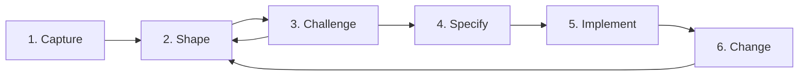

# AI in emod

These proposals add AI to emod. Each AI feature uses the deterministic check of emod as its authority:
`emod validate`, `emod lint` and the CUE schema. The model proposes a change. The check decides if the
change is valid. A person decides if the change is true for the domain.

Read [`00-llm-foundation.md`](./00-llm-foundation.md) first. It defines the model port, the providers, the
configuration and the repair loop that the other proposals use.

## Who models events

Three kinds of person work on an event model:

| Person | What they do | Surface they use |
| --- | --- | --- |
| Facilitator | Runs the workshop and owns the `.emod` file | The desktop app, an agent such as Claude Code, the editor |
| Domain expert | Knows the business; checks the names, the flows and the specs | The desktop app on a shared screen, the web viewer |
| Developer | Builds the slices; keeps the model in the repository | The editor with the LSP, the CLI, CI |

Event modeling is visual work that a group does in rounds. The group names the facts, puts them on a
timeline, adds the screens, the commands and the views, draws the contexts, and writes the specs. Each
round changes the model, and each change comes from a discussion.

Therefore AI in emod must help inside a round, on the diagram, with the people in the room. It must not
replace the discussion. A command that writes a full model in one step hides the decisions that the
workshop exists to make. The domain expert then reviews assumptions that nobody stated, and the model loses
the knowledge that the discussion gives.

## The workflow

The `.emod` file in git is the single source of truth. Each surface has one job:

| Surface | Job |
| --- | --- |
| Desktop app | The workspace for a workshop: open the file, see the diagram, edit it, see the diagnostics |
| Web viewer | Share and read the model with no install; make small edits |
| Editor and LSP | Text edits for developers |
| CLI | CI checks, and the check that agents call through `emod mcp` |

1. **Capture.** The facilitator gives the requirements, the workshop notes or a codebase to an agent that
   has `emod mcp` ([01](./01-mcp-server.md)). The agent asks questions, then writes the first `.emod`
   ([04](./04-model-from-conversation.md)). The desktop app has the file open. It reloads the file when the
   file changes on disk, so the group sees the diagram change after each write. A team with an event
   catalog, AsyncAPI or emlang files imports them with no LLM ([07](./07-model-import.md)).
2. **Shape.** The group discusses the diagram. People make small changes in the viewer: drag, rename, add a
   slice. For a structural change such as "add a refund path", the agent edits the file. A person with no
   agent uses the AI panel in the desktop app ([03](./03-desktop-ai-panel.md)). Each change
   passes the check before the group sees it. The group asks about the model with exact queries:
   references, paths and highlights ([exact model queries](../model-queries-proposal.md)).
3. **Challenge.** The facilitator starts the semantic review when the group is ready
   ([02](./02-semantic-model-review.md)). Its findings show next to the lint findings. The group accepts or
   rejects each finding. The AI does not decide. In a DCB context, the review also suggests `tags` and
   `decides_on` ([DCB knowledge](./02-semantic-model-review.md#dcb-knowledge)).
4. **Specify.** The group writes Given-When-Then specs in the model for each slice. The AI suggests the
   rejection and branch specs that the slice does not have ([05](./05-spec-suggestions.md)). The domain
   experts check them in the AI panel of the desktop app, or on the spec cards that `emod diagram --specs`
   draws in the SVG.
5. **Implement.** A pull request carries the `.emod` file. CI runs `emod validate`, `emod lint`,
   `emod fmt --check` and `emod slices arrange --check`, and renders the SVG and the glossary. Developers
   build one slice at a time. The specs export to test fixtures with no LLM.
6. **Change.** Each later change goes through the same pull request path. The developer renames an element
   with the LSP, and every reference changes with it ([06](./06-rename-and-fix-suggestions.md)).

## Principles

Every proposal follows these rules:

1. **Exact before AI.** If emod can compute an answer, emod computes it. "Who reads this event", "what
   references this command" and "rename this event" have exact answers. AI is for judgement and for words.
2. **The check decides validity.** Each AI output that is `.emod` source passes `oracle.Check` before a
   person sees it. The repair loop sends the diagnostics back to the model until the source is clean or the
   attempts run out.
3. **The person decides meaning.** An AI output is a suggestion with a diff. Nothing changes the file until
   a person accepts it.
4. **AI goes to the surface of the user.** Agent users get the MCP server. Desktop users get a panel in the
   app. CLI and CI users get commands. The static web viewer stays free of AI.
5. **The AI knows the whole DSL.** The prompts and the examples cover `spec`, `invariant`, `trigger` and
   screens, slice descriptions, and the DCB `tags` and `decides_on`. The prompts take the rules from
   `internal/linter/descriptions.go` and the grammar from `emod schema`, so they stay current.
6. **The user brings the provider.** emod speaks two protocols: the Anthropic Messages API and the
   OpenAI-compatible Chat Completions API. See [00](./00-llm-foundation.md).

## Proposals

The numbers follow the order of delivery.

| # | Proposal | What the user gets | Surfaces | Phase |
| --- | --- | --- | --- | --- |
| 00 | [AI foundation](./00-llm-foundation.md) | The model port, two protocol adapters, the repair loop, one configuration | All AI surfaces | `anthropic` part built; the `openai` adapter in phase 2 |
| 01 | [MCP server](./01-mcp-server.md) | Any MCP host can check, draw and query a model, and gets prompts for the workflow | Claude Code, Cursor, Zed, other MCP hosts | 1 |
| 02 | [Semantic model review](./02-semantic-model-review.md) | Findings that lint cannot give: absent failure events, a command that does two jobs, words that differ across contexts, specs that do not cover a rule. In a DCB context, suggestions for `tags` and `decides_on`. | CLI, CI, MCP prompt, desktop app, LSP | 2 |
| 03 | [AI panel in the desktop app](./03-desktop-ai-panel.md) | A review button, then chat edits with a diff, accept, reject and undo | Desktop app | 3 |
| 04 | [Model from a conversation](./04-model-from-conversation.md) | Questions first, then a draft with its assumptions | CLI, desktop app, MCP prompt | 4 |
| 05 | [Spec suggestions](./05-spec-suggestions.md) | Suggested Given-When-Then specs in the model; spec export with no LLM | CLI, desktop app, MCP | 4 |
| 06 | [Rename and fix suggestions](./06-rename-and-fix-suggestions.md) | LSP rename with no AI; then AI suggests the new name for a lint finding, and the `dcb/*` fixes | LSP | Rename: any time. AI: 4 |
| 07 | [Model import](./07-model-import.md) | Converters for event catalogs, AsyncAPI and emlang with no AI; code import through an agent | CLI, MCP prompt | Any time |

## Order

| Phase | Work | Why in this place |
| --- | --- | --- |
| 1 | 01 MCP server | Small, and needs no provider code. It gives agent users generation, edits and questions through the host model at once. |
| 2 | 02 semantic review, and the `openai` adapter of 00 | The review gives the value that only AI can give. The second adapter opens the AI features to users outside Anthropic. |
| 3 | 03 AI panel in the desktop app | It is the only feature for people who do not use an editor or an agent. It reuses the review of 02 and the repair loop of 00. |
| 4 | 04 model from a conversation, 05 spec suggestions, AI part of 06 | They make the first draft and the specs faster. MCP hosts already cover them for agent users. |
| Any time | LSP rename of 06, converters of 07, exact model queries | They need no LLM, so they do not wait for the AI work. |

## Work outside these proposals

The workflow also needs two features with no LLM:

- **Exact model queries.** "Who reads this event", "what does this command start" and "what is the path
  from A to B" have exact answers from the model graph. The
  [model queries proposal](../model-queries-proposal.md) gives them in the CLI, in the viewer, in the
  desktop app and as MCP tools. The AI features use these answers as their facts.
- **A model diff.** A reviewer of a pull request needs to see what changed in the model: the slices, the
  events and the specs that the change adds, removes or renames. This feature has no proposal yet.
