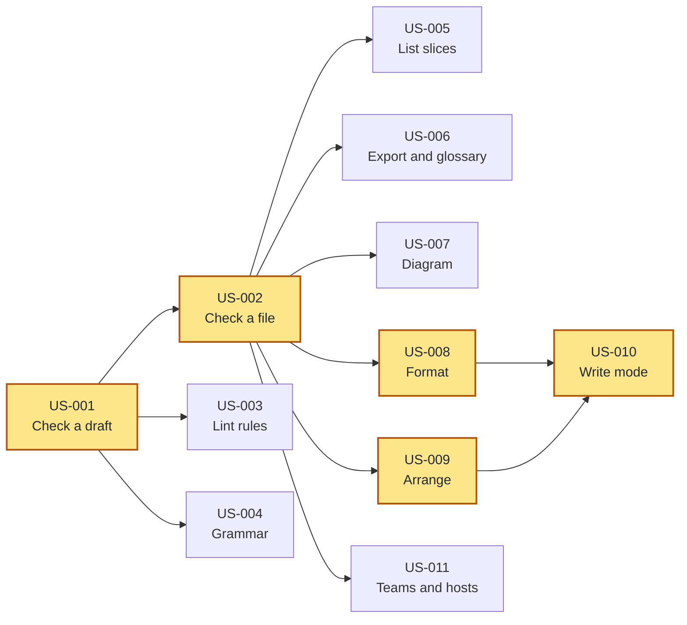

# emod MCP Server

**Proposal:** `docs/proposals/ai/01-mcp-server.md`

## Overview

Many facilitators and developers work with an agent such as Claude Code or Cursor. When an agent drafts a
`.emod` model, it has no way to check the draft before the draft is on disk. The agent writes the file, the
person runs `emod validate`, and the person copies the errors back into the chat. An agent that calls the
`emod` binary itself must parse output for people and guess the meaning of exit codes.

This feature adds `emod mcp`, a server that speaks the Model Context Protocol (MCP). An MCP host, such as
Claude Code, starts the server and gives its tools to the model that it runs. The agent then checks a draft,
reads the grammar, and lists, exports, draws, formats and arranges a model with the same code as the CLI.
emod calls no model. The host brings the model, so emod needs no provider, no API key and no network access.

The design is in [`docs/proposals/ai/01-mcp-server.md`](../docs/proposals/ai/01-mcp-server.md). The
workflow prompts and the query tools of that proposal are in other story sets. See Non-Goals.

## Goals

- An agent checks a `.emod` draft before it writes the file, and gets the same diagnostics as `emod validate`
- The agent reads the grammar, the examples and the lint rules from the `emod` binary, with no text that a
  person pastes into the chat
- The agent lists, exports, draws, formats and arranges a model, and each result is the same as the result
  of the CLI command
- emod adds no LLM code, no provider and no credentials
- The default server is read-only and reads only files under its root, so a person can register it for all
  projects
- A team registers the server once, in a file in the repository

## Delivery Order

All stories need US-001, because it starts the server. US-002 is the bottleneck: six stories read a model
from a path, and they all use its rules for the root. Start US-003 and US-004 at the same time as US-002,
because they need only the server.

The critical path is four stories deep: check a draft, check a file, format or arrange, then the write mode.
Two chains of four tie, because US-010 needs both US-008 and US-009.

## User Stories

### US-001: Check a draft model from an agent

**Goals:** G1, G2, G3, G4, G8

**Description:** As a facilitator who drafts models with an agent, I want the agent to check each draft with
emod before it writes the file, so that I see only models that pass the check.

**Acceptance Criteria:**
- [ ] `emod mcp` starts a server that speaks MCP over stdin and stdout. An MCP host that starts the server
  lists the tool `emod_check`.
- [ ] `emod_check` takes `.emod` text in `content` and returns a list of diagnostics. Each record has
  `file`, `line`, `severity` and `message`, and `rule` when a rule name goes with the diagnostic.
- [ ] For the same source, `emod_check` returns the same records as `emod validate --format json`. A clean
  draft returns an empty list.
- [ ] The records carry the file name from the `name` input, or `inline.emod` when the call gives no `name`.
- [ ] Errors and warnings are normal results. The tool returns an error result (`isError`) only when it
  cannot do the check, for example when the call gives no `content`.
- [ ] The server works with no API key, no `EMOD_AI_*` setting and no network access.
- [ ] The user documentation shows the command that registers the server with Claude Code:
  `claude mcp add emod -- emod mcp`.

**Context:** This story gives the main value of the feature. The agent writes a draft, calls `emod_check`,
reads the records, fixes the draft, and calls again until the list is empty. The loop runs in the agent
turn of the host, and emod gives only the check. `emod validate` and `emod lint` report the same
diagnostics, so one tool serves both. An agent that reads a warning as a failure stops too early, so the
tool marks only a failure to check as an error. The desktop app reloads a file that changes on disk, so a
group with the file open sees each write of the agent on the diagram. This story also carries the main
unknown: the MCP handshake with a real host.

### US-002: Check a model file in the project

**Goals:** G3, G4, G8

**Description:** As a developer who uses an agent in a repository, I want the agent to check a `.emod` file
by its path, so that the agent checks the file on disk and does not copy its text into the call.

**Acceptance Criteria:**
- [ ] `emod_check` accepts `path` in place of `content`. For a regular file under the root of at most
  1 MiB, it returns the same records as `emod validate --format json` for that file. A larger file, a
  directory or a named pipe returns an error result.
- [ ] When a call gives both `path` and `content`, the tool checks `content`.
- [ ] The root is the working directory of the server. `emod mcp --root <dir>` sets a different root.
- [ ] The tool refuses a path outside the root, for example `../../etc/passwd`, an absolute path to another
  folder, or a symbolic link to a file outside the root. Under the root, the tool follows only relative
  symbolic links, so it also refuses an absolute symbolic link. The error result names the root and holds
  no text from the file.
- [ ] A path that does not exist, or that the server cannot read, returns an error result that names the
  path and the cause.
- [ ] The tool never writes to the file.

**Context:** A model can pass any path to a tool. The root limits the server to one project, so a person can
register the server for all projects with no risk to other files. Every later tool that reads a model takes
the same `path` or `content` input and follows these rules.

**Depends on:** US-001

### US-003: Give the agent the lint rules

**Goals:** G2, G6

**Description:** As a facilitator who drafts models with an agent, I want the agent to read why a lint rule
exists, so that the agent fixes the cause of a finding and does not guess.

**Acceptance Criteria:**
- [ ] `emod_explain_rule` takes a rule name, for example `state-obsession`, and returns `rule` and
  `description`. The description is the same text that `emod lint --explain state-obsession` prints.
- [ ] An unknown rule name returns an error result that names the rule, as `emod lint --explain` does.
- [ ] The resource `emod://rules` lists each lint rule with its description.
- [ ] `emod://rules` lists each rule that the linter can report, which includes the `dcb/*` and `spec/*`
  rules, and no other rule. A new lint rule appears in the list with no change to the server.

**Context:** In the worked example of the proposal, a draft names an event `OrderUpdated` and gets
`state-obsession` and `clickbait-event`. The agent reads the description of `state-obsession`, which says to
name the business fact (`OrderShipped`, not `OrderUpdated`), and the second draft is clean. The list of
rules lets the agent avoid the findings in its first draft.

**Depends on:** US-001

### US-004: Give the agent the grammar of emod

**Goals:** G2, G6

**Description:** As a facilitator who drafts models with an agent, I want the agent to read the emod grammar
and examples from emod itself, so that its first draft uses valid syntax and I paste no reference.

**Acceptance Criteria:**
- [ ] The host lists these resources: `emod://schema`, `emod://examples/all_patterns`,
  `emod://examples/dcb_model`, `emod://examples/specs_hotel` and `emod://docs/dsl-reference`.
- [ ] `emod://schema` and the tool `emod_schema` return the same text that `emod schema` prints.
- [ ] Each example resource returns the same text as its file in `examples/`, and each example passes
  `emod_check` with no error.
- [ ] `emod://docs/dsl-reference` returns the same text as `docs/dsl-reference.md`.
- [ ] The server does not serve `examples/error_diagnostics_test.emod`.
- [ ] An installed binary serves each resource from any working directory, with no copy of the emod
  repository on disk.

**Context:** The examples show the four slice patterns, a DCB context with `tags` and `decides_on`, and
Given-When-Then specs with example payloads. `examples/error_diagnostics_test.emod` is a test fixture that
has errors on purpose, so an agent must not learn from it. Some hosts do not read resources without a
request from the person, so the schema is also a tool that the model can call. The text comes from the
binary, so the agent learns the grammar of the emod version that it calls.

**Depends on:** US-001

### US-005: List the slices of a model

**Goals:** G2, G3

**Description:** As a facilitator who works with an agent, I want the agent to list the slices of a model
with their patterns, so that the agent answers questions about the structure from facts.

**Acceptance Criteria:**
- [ ] `emod_slices_list` takes `path` or `content` and returns one record for each slice, with `name`,
  `pattern`, `context` and `keyElements`.
- [ ] For the same source, the records are the same as the output of `emod slices list --format json`.
- [ ] A model with no slice returns an empty list.
- [ ] A source that does not parse returns the parse diagnostics and no list, as `emod slices list` does.

**Context:** The pattern of a slice is `command`, `view`, `automation`, `translation` or `unknown`. The key
elements are the parts that make the slice that pattern, for example the command and its events.

**Depends on:** US-002

### US-006: Export a model and its glossary

**Goals:** G2, G3

**Description:** As a developer who uses an agent, I want the agent to get the model as JSON, CUE or a
glossary, so that the agent reads the structure and the words of the model and does not parse the text.

**Acceptance Criteria:**
- [ ] `emod_export` takes `path` or `content` and a `format`: `json`, `diagram-json` or `cue`. The default
  is `json`, as in the CLI.
- [ ] For `json` and `diagram-json`, the result is the same document as `emod export --format <format>`,
  with the diagnostics in it.
- [ ] For `cue`, a clean source returns the same text as `emod export --format cue`. A source with any
  diagnostic, also a warning, returns the diagnostics and no CUE, as the CLI does.
- [ ] `emod_glossary` takes `path` or `content` and a `format`: `markdown` or `json`, with `markdown` as the
  default. The result is the same text as `emod glossary --format <format>`. A source that does not parse
  returns the parse diagnostics and no glossary, as the CLI does.
- [ ] An unknown format returns an error result that lists the formats of that tool.
- [ ] Neither tool writes a file.

**Context:** `diagram-json` holds every node and every edge of the diagram. With it, an agent follows the
edges between elements from facts. The glossary gives the terms that the model defines, so the agent uses
the words of the model when it writes documents or answers questions.

**Depends on:** US-002

### US-007: Draw a diagram from an agent

**Goals:** G2, G3

**Description:** As a facilitator who works with an agent in a chat, I want the agent to draw the model, so
that I see the shape of a change in the chat before I open the viewer.

**Acceptance Criteria:**
- [ ] `emod_diagram` takes `path` or `content` and a `format`: `svg`, `mermaid`, `ascii`, `event-flow`,
  `event-flow-mermaid` or `event-flow-mermaid-no-icons`. The default is `svg`, as in the CLI.
- [ ] For the same source and options, the result is the same text that `emod diagram` gives for that
  format.
- [ ] `style` accepts `auto`, `projected` and `dcb`, with `auto` as the default, as `emod diagram --style`
  does.
- [ ] `specs: true` draws the Given-When-Then cards in `svg`. With another format, the tool returns an error
  result that says only `svg` draws spec cards, as the CLI does.
- [ ] A source with an error returns the diagnostics and no diagram. A source with only warnings returns
  the diagram and the warnings.
- [ ] The tool writes no file and starts no server.

**Context:** A host shows `mermaid` and `ascii` in the chat. For `svg` and `event-flow`, the tool returns the
SVG text, and the host saves it with its own file tool if the person wants a file. `emod diagram --serve`
starts a viewer server, so the tool has no such option.

**Depends on:** US-002

### US-008: Format a model from an agent

**Goals:** G2, G3

**Description:** As a developer who uses an agent, I want the agent to get the canonical format of a model,
so that the files that the agent writes pass `emod fmt --check` in CI.

**Acceptance Criteria:**
- [ ] `emod_fmt` takes `path` or `content` and returns `formatted` and `changed`.
- [ ] `formatted` is the same text that `emod fmt` writes for that source.
- [ ] `changed` is false when the source is already in the canonical format, and true when it is not. It
  gives the same answer as the exit code of `emod fmt --check`.
- [ ] A source that does not parse returns the parse diagnostics and no text.
- [ ] The tool does not write to the file.

**Context:** CI runs `emod fmt --check` on each pull request. An agent that writes a model in another layout
fails CI. The host writes `formatted` with its own file tool. US-010 adds a mode in which the tool writes
the file itself.

**Depends on:** US-002

### US-009: Arrange the slices of a model from an agent

**Goals:** G2, G3

**Description:** As a developer who uses an agent, I want the agent to arrange the slices and to see the
references that no order can fix, so that the model passes `emod slices arrange --check`.

**Acceptance Criteria:**
- [ ] `emod_slices_arrange` takes `path` or `content` and returns `arranged`, `changed`, `moved`,
  `backwardBefore`, `backwardAfter` and `backward`. Each item in `backward` has `kind`, `label`, `from` and
  `to`.
- [ ] `arranged` is the same text that `emod slices arrange` writes for that source.
- [ ] When no slice moves, `changed` is false and `arranged` is the same as the source. `changed` gives the
  same answer as the exit code of `emod slices arrange --check`.
- [ ] `moved`, `backwardBefore`, `backwardAfter` and `backward` match the report that
  `emod slices arrange` prints for that source.
- [ ] A source that does not parse returns the parse diagnostics and no report.
- [ ] The tool does not write to the file.

**Context:** `emod slices arrange` puts the slices of each context and each aggregate in an order in which
each reference points forward. A backward reference that stays after the arrange is one that no order can
fix, for example a cycle between two slices or a reference into another container. An agent that sees the
list stops a new order that cannot fix the reference. CI runs `emod slices arrange --check` on each pull
request.

**Depends on:** US-002

### US-010: Let a trusted agent write the formatted and arranged model

**Goals:** G8

**Description:** As a developer who trusts the agent in one repository, I want `emod_fmt` and
`emod_slices_arrange` to write their result to the file, so that the agent fixes the layout of a file in one
call.

**Acceptance Criteria:**
- [ ] When the server starts with `emod mcp --allow-write`, `emod_fmt` and `emod_slices_arrange` write their
  result to the file in `path` for a call that gives `write: true`.
- [ ] When the server starts without `--allow-write`, a call with `write: true` returns an error result that
  names the `--allow-write` flag. The file on disk does not change.
- [ ] A call with `write: true` must give `path` and no `content`. Any other call with `write: true` returns
  an error result and writes nothing.
- [ ] A write follows the root of US-002. The tool refuses a path outside the root and writes nothing.
- [ ] When the result is the same as the file, the tool does not write the file, and the modification time
  of the file does not change.
- [ ] A source that does not parse is never written.
- [ ] No other tool writes to disk, with or without `--allow-write`.

**Context:** The default server is read-only, so a person can register it for all projects. The person who
starts the server decides about writes, not the model. With `write: true`, the tool writes only a new layout
of the file that is already on disk. A tool that writes text from the call to disk is a general write tool,
and the host already has its own file tools for that, under the permissions that the person gives the host.

**Depends on:** US-008, US-009

### US-011: Register the server for a team and for other MCP hosts

**Goals:** G1, G8

**Description:** As a developer on a team that uses Claude Desktop, Cursor or Zed, I want instructions and a
project configuration for the emod server, so that each person on the team gets the same tools.

**Acceptance Criteria:**
- [ ] The user documentation shows how to register `emod mcp` in Claude Code, Claude Desktop, Cursor and Zed.
- [ ] The documentation shows a project file, `.mcp.json`, that starts the server with `--root .`, so that
  each person who opens the project gets the server.
- [ ] The emod repository has this `.mcp.json`, and Claude Code starts the server from it in the repository.
- [ ] The server passes the checks of the MCP Inspector: the handshake, the list of tools and a call to
  each tool, and the list and read of each resource.
- [ ] In each of the four hosts, a person who follows the documented steps gets a result from `emod_check`.
- [ ] The documentation says that the server needs no API key and no AI settings.

**Context:** Each host has its own format for the MCP configuration, but the command and its arguments are
the same. The checks against the MCP Inspector and the four hosts find a difference between the hosts
before a user does.

**Depends on:** US-002

## Non-Goals

- **The workflow prompts.** Each prompt goes to the server with the proposal that writes its text:
  - `model-domain` with [04 model from a conversation](../docs/proposals/ai/04-model-from-conversation.md)
  - `review-model` with [02 semantic model review](../docs/proposals/ai/02-semantic-model-review.md)
  - `import-from-code` with [07 model import](../docs/proposals/ai/07-model-import.md)
  - `suggest-specs` with [05 spec suggestions](../docs/proposals/ai/05-spec-suggestions.md)
- **The query tools.** `emod_references` and `emod_trace` go to the server with
  [exact model queries](../docs/proposals/model-queries-proposal.md), which builds `emod references` and
  `emod trace`.
- **Spec export.** `emod_specs_export` goes to the server with
  [05 spec suggestions](../docs/proposals/ai/05-spec-suggestions.md), which builds `emod specs export`.
- No call to a model from emod. emod adds no provider, no API key and no network access.
- No tool that writes `.emod` text from a call to disk. The host writes files with its own file tools.
- No HTTP or SSE transport, and no hosted server for many users.
- No viewer server like `emod diagram --serve`.

## Open Questions

- Proposals 02, 04, 05 and 07 name the tools `emod_lint` and `emod_validate`. This server has one tool,
  `emod_check`, for both. The prompts of those proposals must name `emod_check`.
- Proposal 01 lists the four prompts and the three query and spec tools in its own plan. It must name the
  proposal that delivers each one, so that the proposals agree with these stories.
- One resource for each example works for three files. An index resource that the agent lists, then reads,
  scales better when `examples/` grows.
- Must `emod://schema` carry the emod version, so that a host that keeps the schema across sessions knows
  when the grammar changes?
- A file watch in `emod diagram --serve` gives the same live update to a person without the desktop app. It
  is outside this story set.
