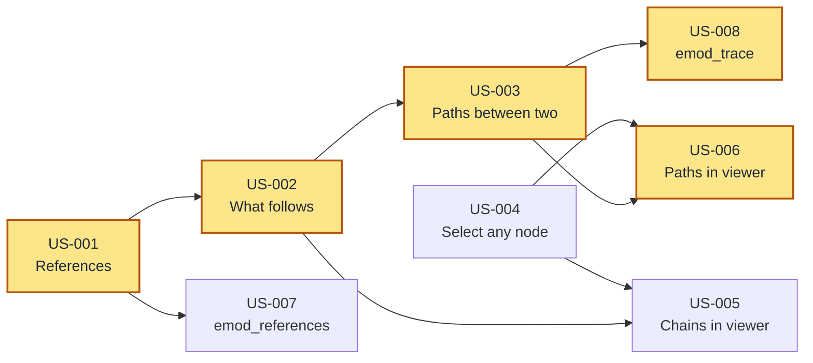

# Exact Model Queries

**Proposal:** `docs/proposals/model-queries-proposal.md`

## Overview

In a workshop, a group asks questions about the graph of its model all the time: who reads an event, what
happens after a command, and how one event leads to another. emod holds the data for each exact answer. But
today only a developer in an editor can get an answer, with find-references, and only one step at a time.

This feature gives the exact answers to each person in the group:

- `emod references` lists the declaration of a name and each reference to it, in a group for each role.
- `emod trace` lists what follows from an element, what leads to it, and the paths between two elements.
- The web viewer and the desktop app highlight the same answers on the diagram, with no AI call.
- An agent gets the same answers from two MCP tools, and uses them as the facts of an answer in words.

Each surface gives the same answer for the same model. The design is in
[the proposal](../docs/proposals/model-queries-proposal.md).

## Goals

The goals are G1 to G6 in [the proposal](../docs/proposals/model-queries-proposal.md): the references
command, the trace command, one answer on each surface, the highlights in the viewer, the MCP tools, and
JSON output for scripts.

## Delivery Order

US-001 is the bottleneck: six stories wait on it, directly or through the trace stories. After it, four
stories wait on US-002, because they use its walk of the graph. US-004 needs no other story, so start it at
the same time as US-001. Both viewer stories that highlight a chain or a path build on it.

The critical path is four stories deep: references, what follows, the paths between two elements, then the
paths in the viewer or the `emod_trace` tool. Two chains of four tie.

## User Stories

### US-001: Find each reference to a name

**Goals:** G1, G3, G6

**Description:** As a model author, I want to list each place where a model names an event, a command, a
view or an invariant, so that the group sees who produces it and who reads it with no search of the file.

**Acceptance Criteria:**
- [ ] `emod references <file> <name>` prints the declaration of the name, then each reference in a group
  for its role. The declaration shows the kind, the context and aggregate, the slice and the line. Each
  reference shows its line, its DSL keyword, the other element, and the slice or the spec. The worked
  example of the proposal shows this output for `RoomReserved` in `examples/all_patterns.emod`.
- [ ] The groups for each kind of name are:
  - event: produced by (`flow`, translation), read by (`subscribes`, `on`), named in specs (`given`,
    `when`, `then`)
  - command: issued by (trigger, automation, translation), produces (`flow`), refused by (`rejected`),
    named in specs (`when`, `then = command(...)`)
  - view: built from (`subscribes`), read by (trigger, automation, translation), named in specs
    (`then = view(...)`)
  - invariant: declared in a scope, refused commands (`rejected` in `flow`), named in specs
    (`then = rejected(...)`)
- [ ] An invariant name that two scopes declare, for example a context and an aggregate, shows one time for
  each scope. Each scope lists only the references that resolve to it.
- [ ] A name that the model declares as two kinds, for example a command and an event, shows one time for
  each kind, and `--kind command|event|view|invariant` shows only one kind. A name that the model does not
  declare exits with code 1 and lists the declared names that are closest to it. A file that does not
  parse stops with its parse diagnostics, as `emod slices list` does.
- [ ] Each place that find-references in the editor returns for the name is in the output. The output also
  shows the links that name no reference: the trigger that issues a command, the translation that
  produces an event, and the events that build a view.
- [ ] Find-references and go-to-definition in the editor also resolve the event that a translation
  declares, because `emod validate` accepts a reference to it. For each other name, the editor returns
  the same places as before this story.
- [ ] `--format json` gives the same declarations and references as the text output. Each reference has
  its group, its keyword, its line, the other element, and the slice or the spec.
- [ ] The README documents `emod references`, with an example from `examples/all_patterns.emod`.

**Context:** The editor already finds the references of a name, but only a developer in an editor can use
it. This story gives the same answer in a terminal, and the two answers must agree: a group that sees two
different answers trusts neither. A spec can name a command or an event in `when`, so one name can match
two kinds. Two scopes can declare one invariant name, and the editor already tells the two apart. The parts
of this story ship as one: a command that knows events but not invariants tells the user that a declared
invariant does not exist.

### US-002: See what follows from an element

**Goals:** G2, G6

**Description:** As a model author, I want to list each element that follows from an element, and each
element that leads to it, so that the group sees the full effect of a command or an event in one answer.

**Acceptance Criteria:**
- [ ] `emod trace <file> <from>` lists each element that follows from `<from>` as a tree, in breadth-first
  order. Each element shows one time, under the first element that reaches it, so a cycle in the model
  does not repeat an element.
- [ ] Each step shows the edge label, the element, its kind, its context, its slice and its line. The
  labels are `flow`, `rejected`, `issues`, `reads`, `subscribes`, `on`, `command` and `from`. An `on` step
  shows the delay of `after`, for example `on, after 15m`. A step into another context says so. The walk
  includes invariants and external systems: for example, the tree from `ReserveRoom` lists the invariant
  `RoomNotDoubleBooked` with the label `rejected`.
- [ ] `--upstream` walks the edges backward and lists what leads to `<from>`. For example, the tree to
  `ConfirmationEmailSent` includes `SendConfirmationEmail`, `ConfirmationEmailReactor` and `RoomReserved`.
- [ ] By default, the walk follows the `subscribes` and `reads` edges. Therefore the tree from
  `RoomReserved` reaches the scheduled automation `UnconfirmedReservationExpirer` through the view that it
  reads. With `--no-views`, the tree holds no view and does not reach `UnconfirmedReservationExpirer`.
- [ ] A name that matches two kinds exits with code 1 and lists the kinds, and `--kind` picks one. A name
  that the model does not declare exits with code 1 and lists the declared names that are closest to it. A
  file that does not parse stops with its parse diagnostics.
- [ ] `--format json` gives the same tree as JSON. Each step has its label, the element, its kind, its
  context, its slice, its line, and the element that reaches it.
- [ ] The README documents `emod trace <file> <from>`, `--upstream` and `--no-views`, with an example.

**Context:** "What happens after a guest reserves a room?" is the most frequent question in a workshop, and
`--upstream` answers the reverse question. A scheduled automation, such as one with `every = "0 2 * * *"`,
has no `on` event. Its only link to the rest of the model is the view that it reads, so a walk with no
views does not show what feeds it. `--no-views` gives the chain of things that the system and the people do,
as in the event-flow diagram.

**Depends on:** US-001

### US-003: Find the paths between two elements

**Goals:** G2, G6

**Description:** As a model author, I want to list the paths from one element to another, so that the group
sees each way in which the model gets from a booking to a confirmation email.

**Acceptance Criteria:**
- [ ] `emod trace <file> <from> <to>` lists the simple paths from `<from>` to `<to>`, shortest first. A
  simple path visits each element one time, so a cycle cannot make the list endless.
- [ ] The output starts with the number of paths. Each path starts with its number of steps and the
  contexts that it crosses, then shows each step with the same fields as the tree of US-002. For
  `RoomReserved` to `ConfirmationEmailSent` in `examples/all_patterns.emod`, the output is the two paths of
  the worked example in the proposal.
- [ ] `--max-paths <n>` sets the most paths to list, and the default is 5. When the model has more paths
  than the limit, the output says that it left out more paths.
- [ ] `--no-views` leaves out the `subscribes` and `reads` edges, as for the tree. For `RoomReserved` to
  `ConfirmationEmailSent`, it lists only the path through the `on` edge.
- [ ] When no path goes from `<from>` to `<to>`, the output says so, and the command exits with code 0.
- [ ] `<from>` and `<to>` resolve by the rules of US-002, with `--kind`. `--format json` gives each path as
  a list of steps with the same fields as the tree, shortest first.
- [ ] The README documents `emod trace <file> <from> <to>` and `--max-paths`, with the worked example.

**Context:** "How does a booking lead to a confirmation email?" has more than one answer when the model has
more than one route. In the example, one route goes through the `on` edge of the automation, and one goes
through the view that the automation reads. A large model can have many simple paths, so the limit keeps
the answer short. The note about the paths left out tells the reader that the list is not complete.

**Depends on:** US-002

### US-004: Select any node to see what it touches

**Goals:** G4

**Description:** As a facilitator, I want a click on any node to show the arrows into it and out of it, so
that the group sees who produces an element and who reads it while it looks at the diagram.

**Acceptance Criteria:**
- [ ] When the user selects a command, an event, a trigger, a view, an automation or a translation, the
  arrows into and out of that node stay as they are, and the viewer dims each other arrow.
- [ ] The viewer highlights the node at the other end of each arrow that stays. For example, a selection
  of `RoomReserved` in `examples/all_patterns.emod` highlights `ReserveRoom`, the views
  `AvailableRoomsView`, `PendingConfirmationsView` and `UnconfirmedReservationsView`, and the automation
  `ConfirmationEmailReactor`.
- [ ] An event copy stands for its original. A selection of the copy or of the original keeps the arrows of
  both, and highlights both.
- [ ] A selection of another node moves the dim arrows and the highlighted nodes to that node. Escape
  clears the selection: no arrow is dim and no node is highlighted.
- [ ] The selection works the same in the web viewer, in `emod diagram --serve` and in the desktop app.

**Context:** Today, a selection dims the other arrows only for a view, and the viewer highlights no node at
the other end. A hover over a view also dims the other arrows, and this story does not change the hover.
The diagram can draw a copy of an event in another slice. For example, the arrow from `RoomReserved` to
`UnconfirmedReservationsView` starts at the copy of `RoomReserved` in the slice "View Unconfirmed
Reservations". Without the rule for copies, a selection of `RoomReserved` does not show that view.

### US-005: Show what follows from a node, and what leads to it

**Goals:** G3, G4

**Description:** As a facilitator, I want to highlight the chain that follows from a node, or the chain
that leads to it, so that the group sees the answer to "what happens after a guest reserves a room?" on the
diagram.

**Acceptance Criteria:**
- [ ] The detail panel of a selected node and the context menu of a node have two actions: **Show what
  follows** and **Show what leads here**.
- [ ] **Show what follows** highlights each node and each arrow of the chain that follows from the node,
  and dims the rest of the diagram. For example, the chain from `RoomReserved` reaches
  `ConfirmationEmailSent` in the `Notifications` context, and `UnconfirmedReservationExpirer` through the
  view that it reads. **Show what leads here** does the same for the chain that leads to the node.
- [ ] For each node of each model in `examples/`, the chain holds the same elements as
  `emod trace <file> <element>`, or as `emod trace --upstream` for **Show what leads here**. The diagram has
  no node for an invariant or an external system, so the chain leaves them out.
- [ ] An event copy stands for its original. The chain treats the copy as the original, and highlights
  both.
- [ ] The chain shows at once when the user picks the action. Escape clears the chain: no node is
  highlighted and no arrow is dim.
- [ ] The actions work the same in the web viewer, in `emod diagram --serve` and in the desktop app.

**Context:** The group sees the answer on the diagram, with no AI call. The chain follows the views by
default, as `emod trace` does, so that the chain shows a scheduled automation. A chain can cover most of a
small model, so the viewer dims the rest and does not remove it.

**Depends on:** US-002, US-004

### US-006: Show the paths between two nodes

**Goals:** G3, G4

**Description:** As a facilitator, I want to pick two nodes and see each path from the first to the second,
so that the group sees how a booking leads to a confirmation email.

**Acceptance Criteria:**
- [ ] With one node selected, a Shift-click on a second node highlights each node and each arrow of the
  paths from the first node to the second, and dims the rest of the diagram. With no node selected, a
  Shift-click selects the node, as a click does.
- [ ] The viewer highlights all paths at the same time, up to the default limit of `emod trace` (5). It
  shows the number of paths, and it says so when it left out more paths.
- [ ] For each pair of nodes in the models in `examples/`, the paths are the paths that
  `emod trace <file> <first> <second>` lists. The paths leave out invariants and external systems, and an
  event copy stands for its original.
- [ ] When no path goes from the first node to the second, the viewer says so, and the first node stays
  selected.
- [ ] Escape clears the paths: no node is highlighted and no arrow is dim.
- [ ] Shift-click works the same in the web viewer, in `emod diagram --serve` and in the desktop app.

**Context:** For `RoomReserved` and `ConfirmationEmailSent` in `examples/all_patterns.emod`, the viewer
highlights two paths: one through the `on` edge of `ConfirmationEmailReactor`, and one through
`PendingConfirmationsView`.

**Depends on:** US-003, US-004

### US-007: Let an agent find the references of a name

**Goals:** G3, G5

**Description:** As a developer who works with an agent, I want the agent to get the references of a name
from emod, so that its answer about the model uses the facts that emod computes and not a guess.

**Acceptance Criteria:**
- [ ] The MCP server lists the tool `emod_references`. It takes the source in `content` or in `path`, as
  `emod_check` does, the name, and an optional kind.
- [ ] For the same model and name, the tool returns the same records as `emod references --format json`.
- [ ] A name that the model does not declare gives an error result that lists the declared names that are
  closest to it, so that the agent can correct the name.
- [ ] A source that does not parse gives its parse diagnostics, as `emod_slices_list` does.
- [ ] The tool works in the default read-only server and reads only files under the root. The README
  lists the tool with the other tools of `emod mcp`.

**Context:** An agent that reads the text of a model to answer "who reads `RoomReserved`?" can add a reader
that the model does not have, or miss one that it has. With this tool, the agent only orders and phrases
the facts.

**Depends on:** US-001

### US-008: Let an agent trace the model

**Goals:** G3, G5

**Description:** As a developer who works with an agent, I want the agent to trace the model with emod, so
that its answer to "how does a booking lead to a confirmation email?" names only paths that the model has.

**Acceptance Criteria:**
- [ ] The MCP server lists the tool `emod_trace`. It takes the source in `content` or in `path`, as
  `emod_check` does, the element to start from, an optional element to end at, and an option for each flag
  of `emod trace`: upstream, no views, the most paths, and the kind.
- [ ] For the same model and inputs, the tool returns the same records as `emod trace --format json`, for a
  tree and for paths.
- [ ] A name that the model does not declare gives an error result that lists the closest declared names.
  A name that matches two kinds, with no kind in the call, gives an error result that lists the kinds.
- [ ] A source that does not parse gives its parse diagnostics, as `emod_slices_list` does.
- [ ] The tool works in the default read-only server and reads only files under the root. The README
  lists the tool with the other tools of `emod mcp`.

**Depends on:** US-003

## Non-Goals

- An LLM in any part of this feature, and an `emod ai ask` command.
- The ask mode of the AI panel in the desktop app. It uses the answers of this feature as facts, and its
  stories come from [the desktop AI panel proposal](../docs/proposals/ai/03-desktop-ai-panel.md).
- The MCP prompts `review-model` and `suggest-specs`, which tell the host to call the two tools. They come
  with [the semantic model review](../docs/proposals/ai/02-semantic-model-review.md) and
  [the spec suggestions](../docs/proposals/ai/05-spec-suggestions.md).
- Questions about the quality of a model, such as "is this event a real business fact?".
- Queries across more than one `.emod` file.
- Highlights of invariants and external systems in the viewer. The diagram has no node for them.
- A change to the hover in the viewer.

## Open Questions

- **`--upstream` with `<to>`.** Does `emod trace <file> <from> <to> --upstream` list the paths from `<to>`
  to `<from>`, or does the command refuse the flag with `<to>`?
- **`--kind` with two names.** One flag cannot pick a kind for both `<from>` and `<to>` when both names
  match two kinds.
- **An invariant in two scopes, in a trace.** `--kind invariant` does not pick one of two scopes that
  declare the same invariant name.
- **Shift-click in the wrong order.** When no path goes from the first node to the second, must the viewer
  also look for paths from the second node to the first?
- **Hover.** A hover over a view dims the other arrows. Must a hover over a node of another kind do the
  same?
- **External systems as nodes.** If the diagram export gets a node for an external system, the viewer can
  highlight `from` edges too.
- **A path through a schedule.** A trace can show the schedule of a scheduled automation, for example
  `every "0 2 * * *"`, as the first step of the chain.
