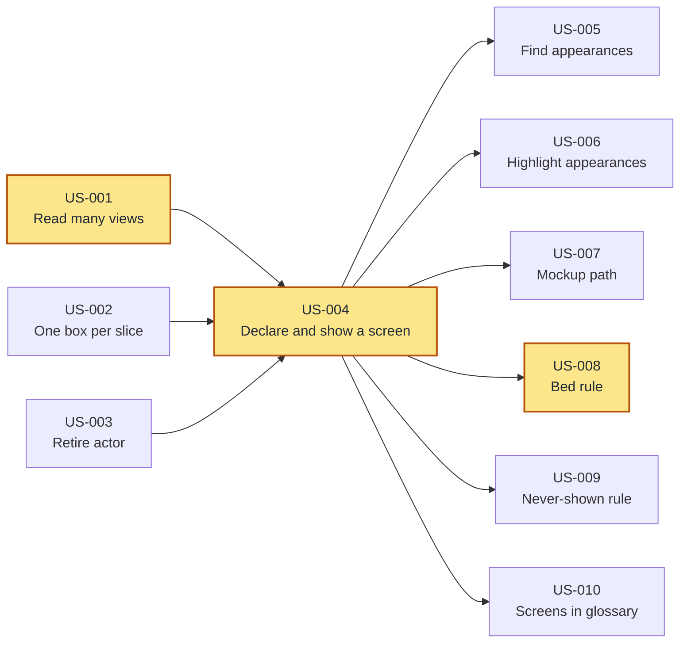

# Screens as a First-Class Element

**Proposal:** `docs/proposals/screens-as-first-class-proposal.md`

## Overview

A screen is one of the five building blocks of Event Modeling. In emod, the `trigger` is the screen, but its
name refers to nothing. When one page appears in two slices, the model holds two unrelated triggers with the
same label. The diagrams then join them incorrectly, and no rule can ask a question about the page across
slices.

This feature gives a screen an identity. A model declares each screen one time, at the top level. Each slice
that shows the screen states an appearance in a `shows` block, with the views that the page reads at that
point and the commands that it issues there. `trigger` and `actor` go. When a screen has an identity, the
model can hold the path of its mockup one time, the linter can find the Bed anti-pattern, and a reader can
follow a page across the timeline.

The design is in [the proposal](../docs/proposals/screens-as-first-class-proposal.md).

## Goals

The goals are G1 to G6 in [the proposal](../docs/proposals/screens-as-first-class-proposal.md): one
declaration for each screen, a split between the screen and its appearances, more than one view for each
appearance, one place for the mockup, the Bed rule, and the retirement of `actor`.

## Delivery Order

US-004 is the bottleneck. It is the breaking change, and six stories wait for it. US-001, US-002 and US-003
have no prerequisite, so they can start at the same time, and each one makes US-004 smaller.

Every chain is three stories deep, so three stories is the critical path. The shaded chain is one of them. It
ends at the Bed rule, which the proposal names as the clearest evidence for the change.

## User Stories

### US-001: Let a trigger read more than one view

**Goals:** G3

**Description:** As a model author, I want a trigger to read more than one view so that a page that shows a
cart and a discount panel can say so.

**Acceptance Criteria:**

- [ ] A trigger accepts `reads = [CartView, DiscountView]`. A trigger with `reads = CartView` stays valid, and
  each `.emod` file in the repository parses with no change.
- [ ] `emod validate` reports each entry that names no declared view, at the position of that entry, with the
  message that it gives for the `reads` of an automation.
- [ ] The SVG and the viewer draw one arrow from each view in the list to the trigger. A view that a far slice
  declares gets a copy in the slice of the trigger, as a single `reads` gets now. The detail panel of the
  viewer lists each view.
- [ ] The ASCII diagram prints one `{CartView} -> <<Checkout Page>>` line for each entry, also when the list
  has one entry.
- [ ] `emod fmt` writes one entry as a bare name and two or more entries as a list. A second run of `emod fmt`
  changes nothing.
- [ ] `view/never-read` counts each entry as a reader. `emod references` lists the trigger as a reader of each
  view in its list, and `emod trace` follows each entry.
- [ ] The JSON and CUE exports give the `reads` of a trigger as a list, and `docs/dsl-reference.md` documents
  the list form.

**Context:** `lint-unread-view` US-002 made a single `reads` of a trigger resolve, so this story adds only the
list. An automation and a translation keep one `reads` name: a processor reads one view as its todo list. The
JSON export changes shape for each model with a trigger, because a string becomes a list. This is phase 1 of
the proposal.

---

### US-002: Keep each trigger in its own slice when two triggers share a name

**Goals:** G1

**Description:** As a reader of a diagram, I want each trigger to keep the arrows of its own slice when another
slice has a trigger with the same name so that the diagram shows what each slice does.

**Acceptance Criteria:**

- [ ] In a model where the slices "Apply Discount" and "Place Order" each have `trigger "Checkout Page"`, the
  SVG draws two boxes, and each box gets the arrows of its own slice only.
- [ ] In the same model, the viewer gives each trigger the `reads` arrow and the command arrows of its own
  slice. No arrow joins a trigger to a command of another slice.
- [ ] When the viewer saves the same model, the source keeps both triggers, each in its own slice.
- [ ] A model where each trigger has a unique name renders the same as before.

**Context:** Today the SVG keeps one box for each name across all slices, and the diagram JSON keeps one ID for
each trigger name. In the model above, the diagram JSON gives all four arrows of the two triggers to the box in
"Place Order", so that box issues `ApplyDiscount`, the command of the other slice. Events, views and commands
already have one box for each slice that declares them. A screen that appears in many slices is the normal
case after US-004, so this defect must go first.

---

### US-003: Retire `actor`

**Goals:** G6

**Description:** As a model author, I want the language to drop `actor` so that I do not keep a name that no
rule checks and no element needs.

**Acceptance Criteria:**

- [ ] A top-level `actor` block fails with an error at the keyword. The error says that the language retired
  `actor` and that the author must delete the block.
- [ ] An `actor` attribute in a trigger fails with an error at the attribute, with the same advice.
- [ ] The SVG and the ASCII diagram label a trigger with its name only, and the event flow diagram gives it the
  caption `trigger`.
- [ ] The viewer shows no bar of actors above the diagram and no actor row in the detail panel.
- [ ] `emod glossary` has no "Actors" group, at the top level or in a context.
- [ ] The JSON and CUE exports, the diagram JSON, a save from the viewer, and the completion, hover and
  highlights of the LSP contain no actor.
- [ ] The examples, `docs/dsl-reference.md` and its copy in `site/content/docs/`, the README and the e2e
  suites contain no `actor`. The cross-reference table has no actor row.

**Context:** No check resolves an actor, and each model in the repository declares at most one. The model only
shows the name: in a label, a caption, the viewer bar and the glossary (proposal, Problem). The proposal
delivers this in phase 2, because the rename to `screen` opens the same files. As a separate story it ships
first, and US-004 does not carry the actor.

---

### US-004: Declare a screen one time and show it in many slices

**Goals:** G1, G2, G3

**Description:** As a model author, I want to declare a screen one time and show it from each slice where it
appears so that the model knows that the page recurs.

**Acceptance Criteria:**

- [ ] A top-level `screen "CheckoutPage" { description = "..." }` declares a screen. `description` is
  optional, so `screen "CheckoutPage" {}` is valid.
- [ ] A slice shows a screen with a `shows` block: `shows { screen = CheckoutPage, reads = [CartView,
  DiscountView], command = ApplyDiscount }`. `reads` and `command` each take one name or a list, and both are
  optional. A slice can hold any number of `shows` blocks.
- [ ] `emod validate` reports each of these at its own position: a screen name that the model declares two
  times, a `shows` block that names no declared screen, a `reads` entry that names no declared view, and a
  `command` entry that names no declared command.
- [ ] A `shows` block draws an arrow to each command that its `command` names, and to no other command. A
  `shows` block with no `command` draws no arrow to a command. A command that an automation issues in the same
  slice gets no arrow from the screen.
- [ ] Two `shows` blocks of one screen in two slices draw two boxes, each with the name of the screen and the
  arrows of its own slice. This holds in the SVG, the viewer, the ASCII diagram and the Mermaid output. The
  detail panel of the viewer lists the views and the commands of the appearance.
- [ ] A file with a `trigger` block fails with an error at the keyword. The error names `screen` and `shows` as
  the replacement.
- [ ] `emod fmt` writes the screens at the top level and the `shows` blocks first in each slice, and a second
  run changes nothing. The JSON and CUE exports give the screens of the model and the appearances of each
  slice.
- [ ] A save from the viewer keeps each screen declaration, also a screen that no slice shows. In the viewer, a
  user can move an appearance into a slice that already holds one.
- [ ] `emod references` lists the `shows` block that issues a command, and each `shows` block that reads a
  view. `emod trace` takes the kind `screen` in place of `trigger`. The event flow diagram takes the issuer of
  a command from the `command` of a `shows` block.
- [ ] `view/never-read` counts each `reads` entry of each `shows` block. Its message and its description name a
  screen, not a trigger.
- [ ] The LSP offers `screen` at the top level and `shows` in a slice, describes both on hover, and highlights
  screen names.
- [ ] The examples, `docs/dsl-reference.md` and its copy in `site/content/docs/`, the quick starts in the README
  and in `site/content/docs/_index.md`, and the e2e suites use `screen` and `shows`. The cross-reference table
  lists `screen`, with `shows { screen }` as its reference.

**Context:** This story has more than seven criteria because its parts ship as one. The proposal retires
`trigger` in the same step that adds `screen`, with no period where both forms are valid. Therefore each
surface that reads a trigger moves in this story. The implementer splits the story into tasks, not into more
stories.

The `command` of a `shows` block is explicit. Today a trigger gets an arrow to each command of its slice, and
that inferred arrow claims a command that an automation issues (proposal, DSL Surface section 2). A model that
leaves out `command` after the migration loses those arrows with no error, so the migration of each example
adds a `command` entry for each command that its screen issues.

A screen label is a name that a bare reference can hold: `screen "ReservationForm"`, not
`screen "Reservation Form"`. The proposal lists the steps to migrate a model by hand (Versioning section).

**Depends on:** US-001, US-002, US-003

---

### US-005: Find each appearance of a screen

**Goals:** G1

**Description:** As a model author, I want to go from an appearance to its screen, and from a screen to each of
its appearances, so that I can follow a page across the timeline.

**Acceptance Criteria:**

- [ ] `emod references <file> CheckoutPage` lists the declaration of the screen and each `shows` block that
  names it, with the slice and the line of each.
- [ ] In an editor, go-to-definition on `CheckoutPage` in a `shows` block goes to the `screen` declaration.
- [ ] In an editor, find-references on a `screen` declaration lists each `shows` block that names the screen.
- [ ] In an editor, completion after `screen =` in a `shows` block offers each declared screen.
- [ ] A screen that no slice shows has a references list with its declaration only.

**Context:** `emod references`, `emod trace` and the LSP take their answers from one package, so each surface
gives the same answer (`user-stories/model-queries.md`). The MCP tools of that feature do not exist yet. When
they ship, they give the same answer for a screen.

**Depends on:** US-004

---

### US-006: Highlight each appearance of a screen in the viewer

**Goals:** G1

**Description:** As a member of a workshop, I want to select one appearance of a screen and see the others so
that the group sees where the page recurs on the timeline.

**Acceptance Criteria:**

- [ ] When the user selects an appearance, the viewer highlights each other appearance of the same screen.
- [ ] The detail panel of an appearance lists each slice where the screen appears. A click on a slice in the
  list selects the appearance in that slice.
- [ ] For a screen that appears in one slice only, the viewer highlights no other box, and the detail panel
  lists one slice.
- [ ] When the user clears the selection, the highlight goes.
- [ ] The desktop app behaves in the same way.

**Context:** `user-stories/model-queries.md` US-004 highlights the producers and the consumers of a selected
node. This story is different: it highlights the boxes that are one screen.

**Depends on:** US-004

---

### US-007: Give a screen the path of its mockup

**Goals:** G4

**Description:** As a model author, I want to give a screen the path of its mockup one time so that each
appearance of the page refers to the same design.

**Acceptance Criteria:**

- [ ] A screen declaration accepts `image = "./wireframes/checkout.png"`, a path relative to the `.emod` file.
  `emod fmt`, the JSON and CUE exports, and a save from the viewer keep it.
- [ ] A model with an `image` path that leads to no file still parses, and its exports and diagrams work.
- [ ] `emod lint` reports `screen/missing-image-asset` at the `image` attribute when the path leads to no file.
  It reports nothing when the file exists.
- [ ] Where no file system is present, as in the web viewer, the rule does not run and reports nothing.
- [ ] `emod lint --explain screen/missing-image-asset` gives a description, and the reference lists the rule.
- [ ] The detail panel of an appearance in the viewer shows the `image` path of its screen.
- [ ] `docs/dsl-reference.md` documents `image`.

**Context:** The attribute is `image`, not `wireframe`, because Event Modeling uses "screen" and "wireframe"
for the same building block (proposal, DSL Surface section 1). A screen has one design, so an appearance has no
`image` of its own.

**Depends on:** US-004

---

### US-008: Flag a screen that issues too many commands

**Goals:** G5

**Description:** As a model author, I want a lint finding when one screen issues many commands so that I
notice a page that tries to be several pages.

**Acceptance Criteria:**

- [ ] `emod lint` reports `bed` at the screen declaration when the appearances of one screen issue 3 or more
  distinct commands across the model.
- [ ] A command that two appearances of one screen both issue counts one time.
- [ ] A screen whose appearances issue 2 distinct commands reports nothing.
- [ ] The message names the screen, the count of commands and the count of slices, for example
  `screen "CheckoutPage" issues 3 commands across 3 slices; consider whether it is several screens, or whether
  the commands express one intent`.
- [ ] `emod lint --explain bed` gives a description, and the reference lists the rule.

**Context:** Bed is one of the four anti-patterns on the canonical cheat sheet, and the only one that emod
cannot state today. The threshold of 3 matches `left-chair`. The count comes from the `command` entries of the
`shows` blocks, not from the commands that a slice declares, so a new command in a slice does not trip the rule
unless a screen issues it.

**Depends on:** US-004

---

### US-009: Flag a screen that no slice shows

**Goals:** G1

**Description:** As a model author, I want a lint finding for a screen that no slice shows so that a screen
declaration does not stay in the model after its last appearance goes.

**Acceptance Criteria:**

- [ ] `emod lint` reports `screen/never-shown` at a screen declaration that no `shows` block names.
- [ ] A screen that at least one slice shows reports nothing.
- [ ] `emod lint --explain screen/never-shown` gives a description, and the reference lists the rule.

**Context:** The rule finds an unused screen. It does not find an appearance that must issue a command and
does not: a `shows` block with no `command` is a valid screen that only shows data (proposal, Risks).

**Depends on:** US-004

---

### US-010: List the screens in the glossary

**Goals:** G1

**Description:** As a member of a workshop, I want the glossary to list each screen with its description so
that the group shares the names of its pages.

**Acceptance Criteria:**

- [ ] `emod glossary` lists each screen, with its description, in a "Screens" group under each context where
  one of its appearances is.
- [ ] A screen that appears in two contexts is listed under both contexts.
- [ ] A screen that no slice shows is listed in the top-level section.
- [ ] The JSON format of the glossary carries the same groups.
- [ ] `docs/dsl-reference.md` says that a screen defines a glossary term.

**Context:** The glossary now groups the actors that triggers name under each context, and lists an actor that
no trigger names at the top level. Screens take that place after US-003 removes the actors.

**Depends on:** US-004

## Non-Goals (Out of Scope)

- Layout, style, or the structure of components on a screen. A screen names its mockup by its path only.
- Navigation between screens. A screen graph is a different model.
- A mockup for each appearance. A second mockup means a second screen.
- Images inside `.emod` files.
- Changes to how `view`, `automation` or `translation` connect.
- A period where `trigger` and `screen` are both valid, and a new language version. The proposal retires
  `trigger` directly (Versioning section).
- A `title` attribute that restores a human label with spaces.
- A tool that migrates a model. The migration is by hand, with the steps in the proposal.

## Open Questions

- `emod validate` exits with 1 on a lint warning. A model whose mockups do not exist yet therefore fails
  `emod validate` because of `screen/missing-image-asset`, but the proposal wants that model to stay usable.
  Which severity must the rule have?
- Which severity must `bed` have? `left-chair` gives an error, and `god-view` gives a warning.
- Must the viewer show the mockup itself, not only its path? In a browser, the viewer cannot read a file next
  to the model.
- The proposal retires `actor` in phase 2, together with the rename. These stories ship it first, as US-003,
  so that US-004 is smaller. If the two must ship as one step, US-003 merges into US-004.
- Assumption: `bed` reports at the screen declaration, not at each appearance.
- Assumption: the glossary lists a screen that no slice shows in the top-level section, as it lists an actor
  that no trigger names now.
